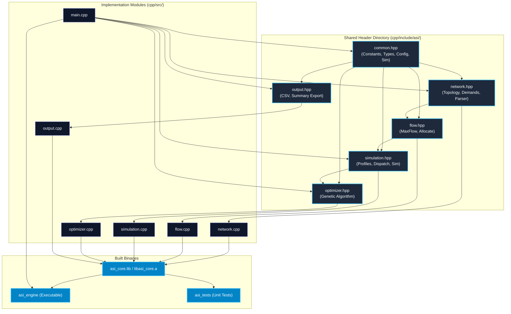

# ASI Smart Power Grid — Architecture & Modular Design

## 1. Executive Overview

The **ASI Smart Power Grid** simulation engine is a high-performance C++17 decision-support and contingency simulation framework coupled with an interactive Python/Streamlit dashboard. It models an autonomous, fault-tolerant **50-consumer, 8-substation meshed microgrid** equipped with distributed renewable assets (solar PV, wind turbines), a battery energy storage system (BESS), and dispatchable backup generation.

The computational core is structured into modular C++ components, cleanly isolating configuration parsing, network topology, graph-theoretic network flow allocation, physical dispatch simulation, genetic algorithm optimization, results export, and top-level process management.

---

## 2. Architectural Principles

1. **Single Responsibility Principle (SRP)**: Each `.cpp` and `.hpp` pair owns exactly one domain of responsibility (e.g., topology definition, Edmonds–Karp network flow, diurnal simulation, evolutionary optimization, or formatted serialization).
2. **Directed Acyclic Dependencies (DAG)**: All common structures and types reside in a dedicated shared header directory (`cpp/include/asi/`), preventing circular dependencies and duplicate definitions.
3. **Decoupled Executable Coordination**: `main.cpp` is strictly limited to initialization, command-line argument validation, execution-mode selection, module coordination, and top-level error handling.
4. **Stable External Contract**: The command-line interface (`asi_engine config.txt hourly.csv summary.txt`), configuration syntax, CSV columns, and summary fields remain backward-compatible with the Python dashboard adapter and automation scripts.
5. **Exact Simulation Parity**: Mathematical formulas, random distributions, and flow-graph construction semantics are preserved identically.

---

## 3. Module Catalog & Responsibilities

```
cpp/
├── include/
│   └── asi/
│       ├── common.hpp       # Shared types, settings, constants, and data models
│       ├── network.hpp      # Topology definitions, consumer IDs, and config parser
│       ├── flow.hpp         # Edmonds-Karp max-flow & two-stage electricity allocation
│       ├── simulation.hpp   # Diurnal profiles, dispatch, battery SOC, operating costs
│       ├── optimizer.hpp    # Genetic algorithm for 24-hour battery scheduling
│       └── output.hpp       # CSV escaping, hourly data export, and summary serialization
├── src/
│   ├── network.cpp          # Topology data, baseline demands, config parsing/validation
│   ├── flow.cpp             # MaxFlow class implementation and flow allocation graph
│   ├── simulation.cpp       # 24-hr simulation loop, battery state machine, cost metrics
│   ├── optimizer.cpp        # GA population, crossover, mutation, elitism, baseline check
│   ├── output.cpp           # File formatters (hourly CSV and summary text)
│   └── main.cpp             # CLI entrypoint, argument handling, mode dispatch, error handling
└── tests/
    └── test_main.cpp        # Standalone C++ unit test suite (topology, flow, sim, optimizer)
```

### 3.1. Common Definitions (`asi/common.hpp`)
- **Mathematical Constants**: $\pi$, number of consumers ($N = 50$), simulation horizon ($H = 24$), substation count ($8$).
- **Core Data Structures**:
  - `Settings`: Microgrid physical constraints, generator costs, battery wear, penalties, and GA parameters.
  - `Config`: Full scenario specification including nominal settings, random seed, execution mode (`simulate` vs `optimize`), fixed battery action chromosome, and contingency capacity overrides.
  - `FlowResult`: Single-hour power allocation metrics (delivered, unserved, critical delivery, source usage, and per-edge flow maps).
  - `Sim`: 24-hour aggregated telemetry, including hourly row dictionaries, total fuel costs, penalties, throughput, and objective value.

### 3.2. Network Topology & Configuration (`asi/network.hpp`, `cpp/src/network.cpp`)
- **Consumer Identification**: Generates formatted consumer designations (`C001`–`C050`) and identifies the 7 critical priority consumers (`C003`, `C010`, `C017`, `C024`, `C031`, `C038`, `C045`).
- **Topology Definitions**:
  - Modeled substations: `S1` through `S8`.
  - Transmission mesh corridors: 16 physical links (ring + cross-ties).
  - Nominal line and substation capacities: 48.0 MW transmission corridors, 82.0 MW substation throughput limit, 5.5 MW consumer feeder limits.
  - Heterogeneous generation source connectivity: Solar connected to S1/S2/S7/S8; Wind connected to S2/S3/S5/S6; Battery connected to S1/S4/S8; Main Generator connected to S3/S4/S7.
- **Baseline Demand Distribution**: Diurnal base distribution across the 50 consumers normalizing to 235 MW nominal baseline.
- **Configuration Parser & Validator**: Parses `key=value` configuration files, deserializes contingency overrides (`line_override`, `sub_override`, `feeder_override`), and validates feeder counts and parameter ranges.

### 3.3. Network Flow & Allocation (`asi/flow.hpp`, `cpp/src/flow.cpp`)
- **Edmonds–Karp Max-Flow (`MaxFlow`)**:
  - Implements breadth-first search (BFS) shortest-augmenting-path maximum flow on directed residual networks with forward and reverse arcs.
- **Two-Stage Critical-First Flow Allocation (`allocate`)**:
  - Constructs a directed graph: `SRC -> SUP:source -> sub:in -> sub:out -> mesh/feeder -> consumer -> SINK`.
  - Node-splitting on substations (`sub:in -> sub:out`) rigorously enforces 82 MW throughput limitations.
  - **Stage 1 (Critical Maximization)**: Arcs are opened only from critical consumers to `SINK`. Edmonds–Karp augments flow to strictly maximize delivery to priority loads first.
  - **Stage 2 (System Maximization)**: Arcs from non-critical consumers to `SINK` are added, and augmentation continues on the **exact same residual graph**. The residual backward arcs allow earlier non-critical paths to be rerouted dynamically without diminishing the secured critical delivery.

### 3.4. Simulation Engine (`asi/simulation.hpp`, `cpp/src/simulation.cpp`)
- **Diurnal Profile Generation**: Deterministic pseudo-random generation of 24-hour solar irradiance, wind speed profiles, and system demand curves using seed-controlled normal perturbations.
- **Battery Energy Storage Accounting**:
  - State of Charge (SOC) tracking in MWh across charge and discharge cycles.
  - Charge efficiency ($\eta_c = 0.94$) and discharge efficiency ($\eta_d = 0.94$).
  - Enforcement of protected reserve margins ($\text{reserveSoc} = 18\text{ MWh}$).
  - Grid discharge rebound accounting: if downstream grid bottlenecks prevent power absorption, unused battery discharge is returned to SOC.
- **Economic Dispatch & Cost Function**:
  $$\text{Cost} = P_{\text{gen}} \cdot C_{\text{gen}} + (P_{\text{charge}} + P_{\text{discharge}}) \cdot C_{\text{wear}} + P_{\text{unserved}} \cdot C_{\text{unserved}}$$
- **Hourly Telemetry**: Emits complete flow telemetry across all 16 transmission lines, 4 generation sources, 100 consumer feeders, and 8 district aggregates.

### 3.5. Genetic Algorithm Optimizer (`asi/optimizer.hpp`, `cpp/src/optimizer.cpp`)
- **Chromosome Representation**: 24 discrete hourly battery actions $a_h \in \{-2, -1, 0, 1, 2\}$ representing full/half discharge, idle, and half/full charge.
- **Evolutionary Operators**:
  - Population initialization with random actions plus the guaranteed all-zero baseline candidate.
  - Fitness evaluation with evaluation caching.
  - Elitism: top 2 chromosomes survive unconditionally.
  - Tournament / rank selection.
  - Single-point crossover with random cut point ($h \in [1, 23]$).
  - Uniform gene mutation ($p_m = 0.10$).
- **Baseline Invariant Guarantee**: After all generations, the best chromosome is explicitly compared against the all-zero schedule ($a_h = 0, \forall h$), ensuring that optimized schedules never perform worse than the unmanaged baseline ($score(\text{best}) \le score(\text{noAction})$).

### 3.6. Output & Serialization (`asi/output.hpp`, `cpp/src/output.cpp`)
- **CSV Escaping**: RFC 4180 compliant escaping for strings containing quotes, commas, or line breaks.
- **Hourly CSV Export**: Outputs high-precision (12 decimals) telemetry with standardized column ordering.
- **Summary Export**: Generates 15-decimal precision key-value metrics file (`summary.txt`) parsed by the Python dashboard adapter.

### 3.7. Entry Point (`main.cpp`)
- Validates CLI arguments (`asi_engine <config_path> <hourly_csv_path> <summary_txt_path>`).
- Supports `--help` / `-h` command-line flags.
- Parses configuration via `asi::readConfig`.
- Selects execution mode: invokes `asi::optimize` if `mode == "optimize"`, otherwise invokes `asi::simulate`.
- Serializes results via `asi::exportHourlyCsv` and `asi::exportSummary`.
- Catches and reports standard exceptions with informative exit codes.

---

## 4. Module Dependency Graph



---

## 5. Execution Dataflow

```mermaid
sequenceDiagram
    autonumber
    actor User as User / Python Adapter
    participant Main as main.cpp
    participant Net as network.cpp
    participant Opt as optimizer.cpp
    participant Sim as simulation.cpp
    participant Flow as flow.cpp
    participant Out as output.cpp

    User->>Main: Execute: asi_engine config.txt hourly.csv summary.txt
    Main->>Net: readConfig("config.txt")
    Net-->>Main: Config (settings, overrides, mode)
    
    alt mode == "optimize"
        Main->>Opt: optimize(config)
        loop Genetic Generations
            Opt->>Sim: simulate(config, chromosome)
            loop 24 Hours
                Sim->>Flow: allocate(solar, wind, battery, gen, scale)
                Flow-->>Sim: FlowResult (delivered, unserved, line flows)
            end
            Sim-->>Opt: Objective Score
        end
        Opt-->>Main: {bestActions, optimizedSim}
    else mode == "simulate"
        Main->>Sim: simulate(config, actions)
        loop 24 Hours
            Sim->>Flow: allocate(solar, wind, battery, gen, scale)
            Flow-->>Sim: FlowResult
        end
        Sim-->>Main: Sim Result
    end

    Main->>Out: exportHourlyCsv("hourly.csv", result)
    Main->>Out: exportSummary("summary.txt", actions, result)
    Main-->>User: Exit Code 0 (Success)
```

---

## 6. Technical Scope and Engineering Boundaries

To maintain scientific integrity and realistic engineering reporting:

1. **Active Power Transport Model**: The framework models active power flows ($MW$) and cumulative energy balances ($MWh$) under directed capacity constraints. It does **not** solve non-linear AC power flow equations (AC-OPF) or compute complex bus voltages, reactive power ($MVAR$), phase angles, frequency regulation, or electromechanical transient stability.
2. **Centralized Swarm Intelligence**: The Genetic Algorithm is an evolutionary population-based metaheuristic acting as a centralized scheduler for the 24-hour battery chromosome. It does not model peer-to-peer decentralized agent consensus or physical multi-agent hardware swarms.
3. **Deterministic Contingency Testing**: Controllable pseudo-random seeds guarantee bit-for-bit repeatability across comparative benchmark scenarios ($N-k$ contingency evaluation).
