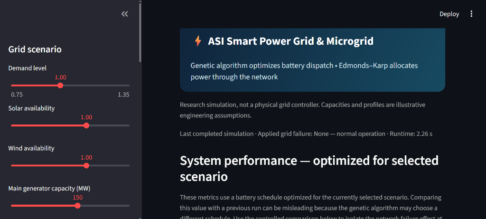

# Hybrid Intelligent Microgrid: Decentralized Swarm Intelligence, ACO Dynamic Rerouting & DC Power Flow

[](CMakeLists.txt)
[](requirements.txt)
[](CMakeLists.txt)
[](dashboard/app.py)
[](ARCHITECTURE.md)

An advanced engineering decision-support framework coupling **Decentralized Multi-Agent Swarm Intelligence**, **Ant Colony Optimization (ACO) Dynamic Rerouting**, **Particle Swarm Optimization (PSO) Resource Allocation**, a **Day-Ahead Genetic Algorithm Battery Scheduler**, and **Linearized DC Power-Flow Modeling** to analyze and maximize microgrid resilience under simultaneous multi-element ($N-k$) grid failures.



---

## What the Project Is

This framework simulates an autonomous, fault-tolerant **50-consumer, 8-substation meshed microgrid** equipped with distributed generation and storage assets:
- **Solar Photovoltaic (PV), Wind Turbine & Hydro Generation**: Diurnal stochastic generation profiles with realistic cloud intermittency, wind turbulence, and run-of-the-river hydroelectric power situated at substations `S4` and `S5`.
- **Battery Energy Storage System (BESS)**: Central battery storage (160 MWh) with state-of-charge (SOC) tracking, charge/discharge power limits, depth-of-discharge (DoD) degradation wear, and protected reserve margins.
- **Substation Local Energy Storage**: 15 MWh dedicated storage per substation (120 MWh system total) providing direct localized support during transmission corridor cuts and component outages.
- **Main Dispatchable Generator**: Baseline thermal backup power subject to physical ramp-rate limits ($|\Delta P_{\text{gen}}| \le 35\text{ MW/h}$).
- **8 Modeled Substations (`S1`–`S8`)**: Interconnected via a 16-corridor mesh transmission network.
- **50 Individually Modeled Consumers**:
  - **7 Critical Priority Consumers**: Healthcare facilities and emergency services (`C003`, `C010`, `C017`, `C024`, `C031`, `C038`, `C045`).
  - **43 Standard Commercial & Residential Consumers**.
  - **Dual Redundant Feeders**: Every consumer is connected to their two nearest substations via independent 5.5 MW distribution feeders (100 total distribution edges).

The system allows operators and researchers to inject arbitrary **$N-k$ multi-contingencies** (simultaneous cuts to transmission corridors, substations, generation sources, and consumer feeders) and observe how decentralized agents and swarm algorithms autonomously coordinate power rerouting to protect critical infrastructure.

---

## Modular System Architecture

The project is structured into clean, decoupled components. The computational core is written in compiled **C++17** and packaged as a static library (`asi_core`), linked to the standalone solver executable (`asi_engine`) and test runner (`asi_tests`). The Python layer serves as a dashboard adapter and visualization interface.

```
                    ┌────────────────────────────────────────────────────────┐
                    │               Streamlit SCADA Cockpit                  │
                    │   • Interactive Full-Width SCADA Cartography Map       │
                    │   • Dynamic Edmonds–Karp Rerouting & Deficit Analysis  │
                    │   • Granular Transmission Line & Plant Outage Controls │
                    │   • DC Power Flow, Substation Reserves & SOC Curves    │
                    │   • High-Performance SCADA Telemetry & Zero-Emoji UI   │
                    └──────────────────────────┬─────────────────────────────┘
                                               │
                                       config.txt / CSVs
                                               │
                                               ▼
┌────────────────────────────────────────────────────────────────────────────────────────┐
│                        Compiled C++17 Solver Core (asi_core)                           │
│                                                                                        │
│   agent.cpp         • Decentralized substation & DER agents, peer-to-peer negotiation  │
│   aco.cpp           • Ant Colony Optimization, corridor pheromones & detour discovery   │
│   pso.cpp           • Particle Swarm Optimization resource dispatch with ring topology  │
│   power_flow.cpp    • Linearized DC power flow (B_bus matrix, angles, I^2*R losses, Δf) │
│   network.cpp       • Topology, 50 consumers, baseline demands, electrical impedances  │
│   flow.cpp          • Edmonds–Karp algorithm & two-stage priority flow allocation      │
│   simulation.cpp    • 24-hr diurnal profiles, physical ramp rates, battery degradation │
│   optimizer.cpp     • Genetic Algorithm battery scheduler (Tournament Selection)       │
│   output.cpp        • High-precision hourly CSV export, summary metrics, message log   │
│   main.cpp          • Program CLI entrypoint, argument parsing, orchestration          │
└────────────────────────────────────────────────────────────────────────────────────────┘
```

> **Full Architectural Details**: See [**ARCHITECTURE.md**](ARCHITECTURE.md) for the module dependency graph, lifecycle sequence diagrams, and mathematical formulations.

---

## Core Algorithms & Swarm Intelligence

### 1. Decentralized Multi-Agent Swarm
- **Substation Agents (`S1`–`S8`)**: Maintain local bus voltage angles $\theta_i$, voltage magnitudes $V_i$, local generation, consumer demand, and connected line health.
- **Peer-to-Peer Coordination**: When an $N-k$ outage strikes, adjacent agents negotiate power transfers (`REQUEST_POWER`, `OFFER_POWER`) without requiring a single central master controller.
- **Autonomous Islanding & Priority Shedding**: Isolated microgrid clusters autonomously shed standard non-critical feeders while strictly preserving 100% of critical healthcare and emergency load.

### 2. Ant Colony Optimization (ACO) Dynamic Rerouting
- Artificial ants deposit pheromone on the 16 corridors based on electrical reactance and remaining capacity margin.
- When an active transmission line is severed, pheromone rapidly evaporates, guiding ants to discover and reinforce alternative multi-hop detour paths around bottlenecks.

### 3. Particle Swarm Optimization (PSO) Resource Allocation
- Optimizes continuous generator and battery setpoints within physical ramp limits ($|\Delta P_{\text{gen}}| \le 35\text{ MW/h}$) and SOC boundaries.
- Uses a decentralized ring neighborhood topology ($lbest_i$), ensuring distributed consensus.

### 4. Linearized DC Power Flow & Physical Losses
- Solves $B_{\text{bus}} \vec{\theta} = \vec{P}_{\text{net}}$ across active corridors to compute bus voltage angles.
- Computes physical transmission losses:
  $$P_{\text{loss}, uv} \approx \left(\frac{P_{uv}}{V_{\text{nom}}}\right)^2 R_{uv}$$
- Evaluates bus voltage stability margins and system frequency deviation proxy $\Delta f$.

### 5. Genetic Algorithm Day-Ahead Battery Scheduler
- Optimizes a 24-hour chromosome of discrete battery actions $a_h \in \{-2, -1, 0, 1, 2\}$.
- Implements **3-way Tournament Selection**, elitism, single-point crossover, and mutation.
- **Guaranteed Baseline Invariant**: $score(\text{best}) \le score(\text{noAction})$.

### 6. Two-Stage Priority Edmonds–Karp Network Flow
- Formulates power routing as a directed capacity-constrained flow graph biased by ACO detour weights: `Sources → Substations → Transmission Mesh → Feeders → Consumers`.
- Enforces an 82 MW throughput limit on each substation using node-splitting (`sub:in → sub:out`).
- **Stage 1 (Critical Maximization)**: Augments flow strictly to critical healthcare and emergency facilities first.
- **Stage 2 (System Maximization)**: Continues flow augmentation on the same residual graph for standard consumers.

---

## Repository Structure

```
ASI_Smart_Power_Grid/
├── CMakeLists.txt              # CMake build configuration (asi_core, asi_engine, asi_tests)
├── ARCHITECTURE.md             # Complete architecture and mathematical specification
├── README.md                   # Project overview, quickstart, and documentation
├── build_cpp.bat               # Windows batch script to build C++ engine
├── run_dashboard.bat           # Setup virtual environment and launch Streamlit UI
├── run_tests.bat               # Run C++ unit tests and Python test suite
├── requirements.txt            # Python dependencies (Streamlit, Plotly, Pandas, Pytest)
├── cpp/
│   ├── include/
│   │   └── asi/
│   │       ├── common.hpp      # Types, Settings, Config, FlowResult, Sim, AgentMessage
│   │       ├── network.hpp     # Grid topology, consumer IDs, baseline demands, parser
│   │       ├── flow.hpp        # MaxFlow class & two-stage flow allocation logic
│   │       ├── simulation.hpp  # Diurnal profiles, ramp rates, battery degradation
│   │       ├── optimizer.hpp   # Genetic algorithm battery optimizer (Tournament Selection)
│   │       ├── power_flow.hpp  # DC Power Flow solver, transmission losses, voltage drop
│   │       ├── aco.hpp         # Ant Colony Optimization dynamic routing & pheromones
│   │       ├── pso.hpp         # Particle Swarm Optimization resource allocation
│   │       ├── agent.hpp       # SubstationAgent, DerAgent, MultiAgentGridSystem
│   │       └── output.hpp      # CSV escaping, hourly data export, summary output
│   ├── src/
│   │   ├── network.cpp         # Topology definitions, baseline demand, config reading
│   │   ├── flow.cpp            # Edmonds-Karp residual graph and allocation implementation
│   │   ├── simulation.cpp      # Physical dispatch, SOC tracking, resilience metrics
│   │   ├── optimizer.cpp       # GA population, tournament selection, mutation, elitism
│   │   ├── power_flow.cpp      # B_bus linear solver, I^2*R losses, bus angles, voltages
│   │   ├── aco.cpp             # Pheromone matrix, ant pathfinding, detour discovery
│   │   ├── pso.cpp             # Particle velocity/position updates with ring topology
│   │   ├── agent.cpp           # Agent sensing, peer-to-peer negotiation, load shedding
│   │   ├── output.cpp          # Telemetry formatting, summary, message CSV export
│   │   └── main.cpp            # CLI entrypoint, argument parsing, mode dispatch
│   └── tests/
│       └── test_main.cpp       # Standalone C++ unit test suite (9 test cases)
├── dashboard/
│   ├── app.py                  # Streamlined SCADA cockpit UI (dynamic map, reroute telemetry, failure simulation)
│   ├── microgrid.py            # Python adapter invoking asi_engine executable
│   ├── network_flow.py         # Static topology metadata and feeder endpoint mapping
│   └── topology.py             # Plotly cartographic visualization of microgrid
├── tests/
│   ├── test_core.py            # Pytest suite for flow balance and optimizer repeatability
│   ├── test_network_scenarios.py # Pytest suite for N-k outage & capacity contingencies
│   ├── test_dc_power_flow.py   # Pytest suite for bus angles, voltages, and losses
│   ├── test_swarm_agents.py    # Pytest suite for multi-agent peer-to-peer messages
│   └── test_comparison_baseline_vs_swarm.py # Pytest suite for benchmark comparison
├── sweep_corridors.py          # Batch evaluation script for N-1 transmission line cuts
├── test_corridor_outage.py     # Standalone S3-S5 physical corridor cut benchmark
└── test_line_outage.py         # Standalone transmission line outage benchmark
```

---

## Quickstart & How to Run

### 1. Launch the Web Dashboard (Windows)
Double-click `run_dashboard.bat` or run:
```cmd
run_dashboard.bat
```
Alternatively, using Python directly:
```bash
.venv\Scripts\python.exe -m streamlit run dashboard\app.py
```
Open [http://localhost:8501](http://localhost:8501) in your browser.

### 2. Run All Automated Tests
To run both the compiled **C++ unit tests** and the **Python pytest suite**:
```cmd
run_tests.bat
```
Or run individually:
```bash
# C++ unit tests (9 test suites)
build\Release\asi_tests.exe

# Python integration tests (18 test suites)
.venv\Scripts\python.exe -m pytest -v tests
```

### 3. Build the C++ Solver Engine Standalone
```cmd
build_cpp.bat
```
Or via CMake:
```bash
cmake -S . -B build
cmake --build build --config Release --parallel
```

### 4. Run the C++ Engine from the CLI
```bash
build\Release\asi_engine.exe <config_path> <hourly_csv_path> <summary_txt_path> [messages_csv_path]
```

---

## Comparative Resilience Metrics

The simulator evaluates both the **Decentralized ASI Swarm** and the **Centralized Baseline** across multiple dimensions:
- **Recovery Time (Hours)**: Time elapsed until critical facility service returns to $\ge 99\%$ following contingency injection.
- **Critical-Load Restoration Ratio (%)**: Percentage of emergency and hospital load successfully maintained.
- **Cascading Failure Containment Factor**: Fraction of operational lines avoiding thermal overload trips.
- **Physical Transmission Losses (MWh)**: $I^2 R$ electrical transmission dissipation across all active corridors.
- **Voltage Stability Margin**: Minimum per-unit bus voltage magnitude ($V_{\text{min}}$) maintained.
- **Operating Cost ($)**: Total thermal generator fuel, battery degradation wear, and unserved energy penalties.
