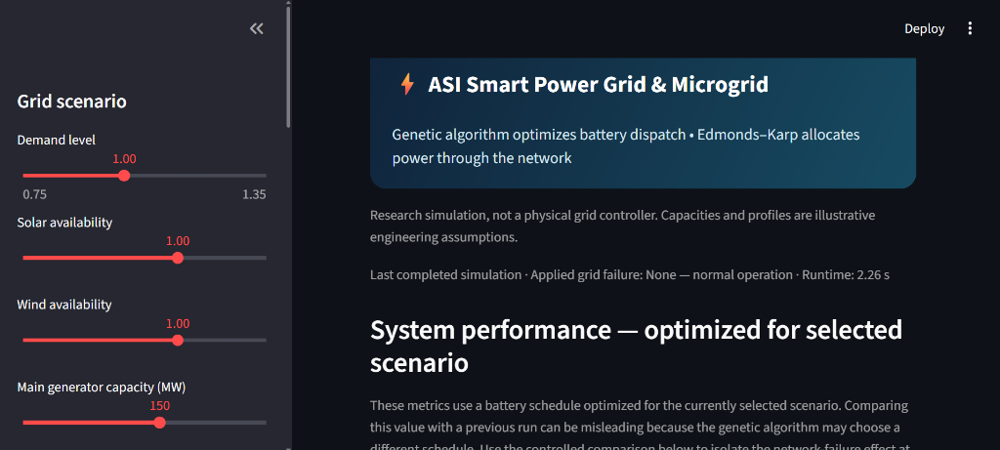

# Resilient Microgrid Power Dispatch & Critical Flow Allocation under N-k Multi-Contingencies

An engineering simulation and decision-support framework coupling **Artificial Swarm Intelligence (Genetic Algorithm)** with a **two-stage critical-first Edmonds–Karp network flow allocator** to model and analyze microgrid resilience under simultaneous, multi-element ($N-k$) grid failures.



---

## What the Project Is

This project models an autonomous, fault-tolerant **50-consumer, 8-substation mesh microgrid** equipped with distributed, heterogeneous generation assets:
- **Solar Photovoltaic (PV) & Wind Turbine generation** (diurnal stochastic generation profiles)
- **Battery Energy Storage System (BESS)** with state-of-charge (SOC) accounting, charge/discharge power limits, and protected reserve margins
- **Main Dispatchable Generator** for baseline backup power
- **8 Modeled Substations (`S1`–`S8`)** interconnected via a 16-corridor mesh transmission network
- **50 Individually Modeled Consumers**:
  - **7 Critical Priority Consumers** (e.g., healthcare facilities, emergency services: `C003`, `C010`, `C017`, `C024`, `C031`, `C038`, `C045`)
  - **43 Standard Commercial & Residential Consumers**
  - **Dual Redundant Feeders**: Every consumer is connected to their two nearest substations via independent 5.5 MW distribution feeders.

The system allows operators and researchers to simulate **$N-k$ multi-contingencies** (arbitrary simultaneous cuts to transmission corridors, substations, generation sources, and consumer feeders) and observe how the grid autonomously reroutes power and protects critical loads.

---

## Core Algorithmic Architecture

The computational engine is implemented in compiled **C++17** for high-performance sub-second solving, coupled via a Python adapter to an interactive **Streamlit** dashboard.

```
                    ┌──────────────────────────────────────────────┐
                    │               Streamlit UI                   │
                    │   • Interactive Cartographic Topology Map    │
                    │   • Multi-Element Contingency Injection      │
                    │   • 24-hr Dispatch & Battery SOC Plots       │
                    └──────────────────────┬───────────────────────┘
                                           │
                                  config.txt / JSON
                                           │
                                           ▼
                    ┌──────────────────────────────────────────────┐
                    │         Compiled C++17 Solver Engine         │
                    │                  (asi_engine)                │
                    │                                              │
                    │  1. Swarm Intelligence (Genetic Algorithm)   │
                    │     • 24-hour discrete battery schedule      │
                    │     • Cost, wear & penalty optimization      │
                    │                                              │
                    │  2. Edmonds–Karp Max-Flow Allocation         │
                    │     • Node-split substation throughput       │
                    │     • Phase 1: Critical-load priority flow   │
                    │     • Phase 2: Standard-load augmentation   │
                    │       (retaining same residual graph)        │
                    └──────────────────────────────────────────────┘
```

### 1. Artificial Swarm Intelligence (Genetic Algorithm Dispatch)
- Optimizes a 24-hour chromosome of discrete battery actions $a_h \in \{-2, -1, 0, 1, 2\}$ (full/half discharge, idle, half/full charge).
- Balances generation against demand, minimizes expensive generator fuel consumption and battery wear, and prevents costly unserved energy penalties ($18,000/MWh).
- Implements elitism, crossover, mutation, and a guaranteed baseline comparison against the no-action schedule ($score(best) \le score(noAction)$).

### 2. Two-Stage Priority Edmonds–Karp Network Flow
- Formulates power routing as a directed capacity-constrained flow graph from sources $\rightarrow$ substations $\rightarrow$ transmission corridors $\rightarrow$ feeders $\rightarrow$ consumers.
- **Stage 1**: Connects only critical consumers to the sink to maximize their delivered power first.
- **Stage 2**: Adds non-critical consumers and continues flow augmentation on the **exact same residual graph**. Reverse residual edges allow earlier non-critical routes to be rearranged without reducing the secured flow to critical loads.

---

## Repository Structure

- `cpp/src/main.cpp`: C++17 implementation of Edmonds–Karp max-flow, capacity-constrained network allocation, critical-first service, battery SOC accounting, 24-hour simulation, and the genetic algorithm optimizer.
- `CMakeLists.txt`: Portable CMake build configuration.
- `dashboard/app.py`: Interactive Streamlit dashboard with cartographic topology atlas, failure selector, and hourly scrub controls.
- `dashboard/topology.py`: Plotly cartographic visualization showing grid assets, substations, and dynamic consumer service colors.
- `dashboard/network_flow.py`: Static topology metadata and visual-map feeder endpoint mapping.
- `dashboard/microgrid.py`: Python adapter serializing configuration, spawning `asi_engine`, and parsing hourly results.
- `tests/`: Automated pytest test suite verifying flow balance, demand conservation, feeder isolation, and contingency handling.
- `sweep_corridors.py`: Batch evaluation script running N-1 transmission corridor cuts across all 16 lines.
- `test_line_outage.py` & `test_corridor_outage.py`: Standalone contingency verification benchmarks.

---

## Requirements

- **Python**: 3.11 recommended
- **CMake**: 3.16+
- **C++ Compiler**: C++17 compatible (Visual Studio 2022 Build Tools with Desktop development with C++, GCC 9+, or Clang 10+)

---

## Run on Windows

1. Run `run_dashboard.bat`. It creates `.venv` if needed, installs Python dependencies, builds the C++ engine with CMake, and starts Streamlit.
2. Or run `build_cpp.bat` to compile the C++ engine standalone (`asi_engine.exe`).
3. Run `run_tests.bat` to execute the full automated test suite.

---

## Unserved Demand and Outage Semantics

For every hour and consumer, the engine records demand, delivered power, and unserved power ($\max(0, \text{demand} - \text{delivered})$). System unserved energy is the sum of hourly unmet demand. The simulation checks that source delivery, consumer delivery, and demand accounting reconcile within floating-point tolerance ($< 10^{-5}\text{ MW}$).

Failed source connections, directional corridors, substations, and consumer feeders have their modeled capacity set to zero. A failed substation also disables attached source links, mesh links, and feeder links.

The source-to-substation topology is deliberately sparse so transmission corridors are necessary for transfers; otherwise direct source connections to every substation would make corridor failures trivial.

---

## Controlled Baseline Comparison

The headline metrics report values for a battery schedule optimized for the currently active scenario. Comparing raw metrics across separate runs can be misleading because the Genetic Algorithm may choose different battery actions for each scenario. 

The dashboard's **Failure impact vs. same dispatch without failures** panel provides the controlled comparison: it replays the exact same 24 battery actions, random seed, and renewable profile with and without the selected network failures to isolate the pure physical impact of the outages.

---

## Technical Scope & Modeling Boundaries

This is a research and educational **capacity-constrained network-flow (transport) model**, not a full AC power-flow or protection-grade grid controller. It models active power ($MW$) and energy balance ($MWh$), but does not compute complex bus voltages, reactive power ($MVAR$), phase angles, frequency dynamics, or transient stability limits.
